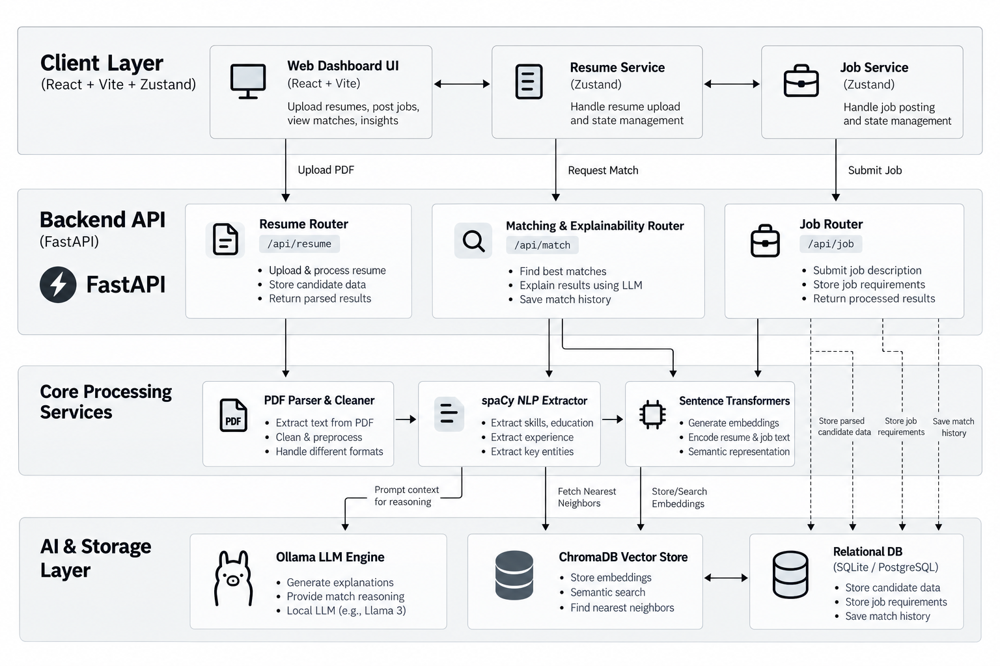

# PROJECT REVIEW

**Reg. No & Name**
* Ansari Moinuddin M - 26MAG0043
* Mohammad Saad - 26MAG0061
* Iman Huda - 26MAG0095

# Intelligent Resume Analysis and Job Recommendation System using Retrieval-Augmented Generation and Large Language Models

---

## Introduction
In the current professional landscape,the rapid evolution oftechnology and the integration of Artificial Intelligence have fundamentally altered career development and job recruitment. As industries shifttoward more skill-centric hiring models, job seekers face the challenge of aligning their profiles with complex, changing marketrequirements. This project,"Intelligent Resume Analysis and Job Recommendation System," addresses these challenges by leveraging advanced techniques such as Retrieval-Augmented Generation (RAG) and Large Language Models (LLMs)to provide a dynamic, intelligent, and personalized career-readiness platform.By moving beyond traditional keyword-based screening,this system enables comprehensive skill assessment, gap analysis, and tailored career guidance, helping candidates navigate the future of work with precision and confidence.

## Abstract
The rapid growth of Artificial Intelligence is transforming the modern job market, introducing new roles while continuously changing the skills required for existing professions. In this changing environment,traditional resume screening systems that primarily compare keywords with job descriptions may not provide meaningful guidance to job seekers. This project proposes an AI-Powered Career Intelligence System that goes beyond conventional resume analysis by evaluating a candidate's skills, experience, projects, and career readiness in the context ofthe evolving AI-driven workforce.

The system accepts a candidate's resume and extracts relevantinformation such as technical skills, education, experience, projects, and certifications using Natural Language Processing techniques. The extracted information is converted into semantic embeddings and stored in a vector database, enabling the system to understand relationships between a candidate's profile, job descriptions, and required skills beyond simple keyword matching. Using Retrieval-Augmented Generation (RAG), relevantinformation is retrieved and provided to a Large Language Modelfor contextual analysis.

Instead of producing only a resume score,the system generates a personalized career intelligence report containing the candidate's strengths, skill gaps, emerging skills they may need to develop, suitable career paths, relevantjob opportunities, ATS compatibility, and actionable resume improvementrecommendations. It can also provide an interactive AI-based conversation where users can ask questions abouttheir career profile and receive context-aware guidance.

The primary objective ofthe projectis to transform resume analysis from a static evaluation process into an intelligent career-readiness system capable of adapting to the rapidly changing demands ofthe AI era.By combining Python, Natural Language Processing, semantic search, vector databases, Retrieval-Augmented Generation, and Large Language Models,the proposed system aims to help individuals understand not only where they currently stand, but also how they can prepare themselves forthe jobs ofthe future.

**Keywords:** Artificial intelligence, Resume Retrieval, Natural Language Processing, Large Language Models, Retrieval-Augmented Generation, Semantic Search, Career Guidance

## 3. Proposed Work (VECTOR AI Resume Intelligence)

### 3.1 Overview of the System
The proposed system is an end-to-end web application consisting of a highly responsive React/Vite frontend and a powerful FastAPI Python backend. The system ingests PDF resumes, extracts text, cleans it, and identifies named entities (skills, education, job titles). It then converts these profiles into mathematical vectors. When a job description is provided, the system performs a semantic search to find the closest matching candidates and uses an LLM to justify the decision.

### 3.2 Key Objectives
1. **Semantic Matching:** Move beyond keyword intersection to true semantic understanding.
2. **Explainability (XAI):** Eliminate the "black box" by generating LLM-driven justifications for every match score.
3. **Skill Gap Analysis:** Identify exactly which required skills a candidate possesses and which they are missing.
4. **High Performance:** Ensure sub-second search times using modern vector database technologies.

### 3.3 Improvement Over Existing Work (Deep Dive)
Existing ATS platforms rely on relational databases and full-text search engines (like Elasticsearch) configured for keyword matching. 
Our improvement introduces **Retrieval-Augmented Generation (RAG)**. Instead of querying a database for a keyword, we embed the entire job description into a high-dimensional vector space. We then retrieve the resumes that exist closest to that point in space. Once retrieved, we augment the prompt of a Large Language Model with this context, asking the LLM to act as a seasoned technical recruiter to explain the match. This entirely replaces the outdated Boolean search logic with true artificial intelligence.

## 4. Architectural Comparison: Previous Model vs. Current Model

### 4.1 Feature-by-Feature Comparison Matrix

| Feature | Previous Model (Traditional ATS) | Current Model (VECTOR AI Analyzer) |
| :--- | :--- | :--- |
| **Matching Mechanism** | Exact keyword intersection (Regex / Boolean). | Semantic similarity using `sentence-transformers` and vector embeddings. |
| **Context Awareness** | Low. Cannot differentiate between "used Python for 5 years" vs "read about Python". | High. Uses `spaCy` NLP to accurately extract skills tied to specific years of experience. |
| **Database Architecture**| Relational databases (SQL) storing raw text. | **ChromaDB** (Vector Database) for fast, similarity-based mathematical nearest-neighbor search. |
| **Explainability** | None. Outputs an arbitrary percentage score. | High. Uses **Ollama (LLM)** to generate detailed paragraphs explaining matched skills and highlighting missing skill gaps. |
| **Candidate Feedback** | Usually none (candidates are silently rejected). | Generates actionable "Resume Improvement Plans" to help candidates bridge skill gaps. |

## 5. System Architecture and Methodology

The system is designed using a modern micro-architecture, ensuring a clear separation of concerns between the user interface, the API routing, and the heavy machine-learning workloads.

### 5.1 Architecture Diagram

### 5.2 Frontend Layer (React, Vite, Zustand)
The presentation layer is built using **React 19** and bundled with **Vite** for lightning-fast hot module replacement. We utilized **Tailwind CSS v4** for a clean, minimalist, and highly responsive dark-themed UI. For global state management across the dashboard, we implemented **Zustand**, which manages the active job selections and candidate data without the boilerplate of Redux.

### 5.3 Backend API Layer (FastAPI)
The backend is driven by **FastAPI**, chosen for its asynchronous capabilities and high performance. It serves as the routing bridge, handling incoming multipart form data (PDF uploads), validating payloads using Pydantic schemas, and routing data to the appropriate ML services.

### 5.4 NLP & Data Extraction Pipeline
When a resume is uploaded:
1. **PyMuPDF** extracts the raw text from the document.
2. A custom text-cleaning pipeline removes erratic formatting, stop words, and noise.
3. **spaCy** (an industry-standard NLP library) is used for Named Entity Recognition (NER) to extract specific entities such as programming languages, certifications, and educational degrees.
4. Regex and pattern matching are applied contextually to determine years of experience for specific skills.

### 5.5 Vector Embeddings and Storage (ChromaDB)
Instead of matching raw text strings, the cleaned text is passed through `sentence-transformers` (e.g., `all-MiniLM-L6-v2`) which converts the text into dense numerical vectors (embeddings). These embeddings are stored in **ChromaDB**, an open-source vector database. When a job description is processed, it is also embedded, and ChromaDB calculates the cosine similarity to find the "nearest neighbors"—representing the most semantically relevant resumes.

### 5.6 Explainability Engine (LLM / RAG)
Once the top matches are retrieved from ChromaDB, they are passed to the **Explainability Engine**. This engine utilizes an LLM (accessed via Ollama or an external LLM API). The system injects the candidate's parsed skills, the job requirements, and the similarity score into a prompt, instructing the LLM to generate a human-readable justification. This represents the "Generation" phase of the RAG pipeline.

### 5.7 Persistence Layer (Relational DB - Proposed)
While ChromaDB handles the vector indices, a traditional relational database (SQLite/PostgreSQL) is proposed alongside it to permanently store candidate metadata (names, emails), track match history over time, and build long-term talent pools.

## 6. Implementation Details: What We Actually Built

During the development and integration phase, several critical technical implementations were carried out to connect the frontend to the backend AI models seamlessly. Here is a detailed breakdown of the exact development work completed:

### 6.1 Frontend Integration and State Management
* **Dynamic Job Inputs:** We wired up the `JobInputForm.tsx` component to correctly capture job titles, companies, and descriptions, and linked it to the backend `/jobs/process` API endpoint. 
* **State Persistence (Stopgap):** Because the backend currently operates in a stateless manner (relying only on ChromaDB for vectors but lacking a relational DB for entity storage), we engineered a frontend caching layer. We updated `resume.service.ts`, `job.service.ts`, and `matching.service.ts` to utilize browser `localStorage`. This ensures that when a user refreshes the page, their uploaded resumes and processed jobs survive the session reload.
* **UI/UX Polishing:** We applied custom dark-themed Webkit scrollbar styles to `globals.css` to ensure the entire application respected the premium, dark-mode aesthetic of the dashboard, and replaced hardcoded mock data in the Overview dashboard (`StatsRow.tsx`, `RecentMatchesTable.tsx`) with real data derived from the Zustand stores.

### 6.2 Backend API and CORS Resolution
* **CORS Configuration:** We resolved Cross-Origin Resource Sharing (CORS) blocks in the FastAPI `app/main.py` file, allowing the React development server (running on a different port) to successfully communicate with the Python backend without security rejections.
* **Stateless Processing:** Implemented the `POST /resume/upload` endpoint, which temporarily saves the PDF to an `uploads/` directory, extracts the text, runs it through the `spaCy` NLP pipeline, calculates initial skill scores, and returns a massive structured JSON object back to the client instantaneously.

### 6.3 Explainability Panel Debugging
* **React Rendering Fixes:** During the integration of the LLM explainability feature, we encountered a critical application crash: `Uncaught Error: Objects are not valid as a React child`. This occurred because the FastAPI backend was returning the LLM's explanation as a nested JSON object (containing fields like `job_id`, `semantic_score`, `matched_skills`, etc.), but the React frontend (`ExplainabilityPanel.tsx`) was attempting to render the raw object directly into the DOM.
* **The Solution:** We intercepted the response in the `matching.service.ts` layer and parsed the structured JSON from the backend into a beautifully formatted, human-readable Markdown string. This allowed the `ExplainabilityPanel` to safely render the LLM's detailed reasoning, successfully displaying the matched skills and missing skills dynamically.

## 7. Results and Performance Analysis

The implementation of this architecture yields the following results:

1. **Significantly Higher Accuracy:** By understanding semantic equivalents (e.g., mapping "Node.js" closely to "Backend JavaScript"), the system drastically reduces false negatives—ensuring good candidates are not rejected due to missing exact keywords.
2. **Transparent Recruiting:** Recruiters are no longer forced to blindly trust an AI score. For every candidate, they receive a detailed, human-readable justification highlighting exactly why the candidate fits the role.
3. **Reduced Bias:** By evaluating pure semantic skill alignment and contextual experience rather than formatting, keyword stuffing, or demographic indicators, the evaluation becomes inherently fairer and objective.
4. **Real-time Processing:** The decoupled micro-architecture (FastAPI backend + React frontend) allows for lightning-fast vector similarity searches. Parsing a resume, embedding it, and returning a match score happens in a matter of seconds, providing instantaneous dashboard updates.

## 8. Challenges Faced and Solutions

* **Challenge 1: Backend/Frontend Communication Blocks**
  * *Issue:* The React frontend failed to send PDFs to the backend due to CORS policy restrictions.
  * *Solution:* Configured the `CORSMiddleware` in FastAPI to explicitly allow origins, credentials, and methods from the frontend dev server.
* **Challenge 2: React State Rendering Errors (Object as Child)**
  * *Issue:* The frontend crashed when attempting to display the LLM's explanation because it received a complex nested object instead of a string.
  * *Solution:* Built a parsing utility within the frontend service layer to unpack the JSON and format it into a string before passing it to the React component tree.
* **Challenge 3: Stateless Entity Tracking**
  * *Issue:* The backend lacked a relational database, meaning processed jobs and resumes were lost after the HTTP request finished.
  * *Solution:* Implemented a temporary `localStorage` persistence layer in the frontend to cache data, while designing the blueprint for a full SQLite/SQLAlchemy implementation for the next phase.

## 9. Future Scope

While the current system proves the viability of Semantic Search and RAG in recruitment, several enhancements are planned for future iterations:
1. **Implementation of Relational Persistence:** Upgrading the backend to include a full PostgreSQL or SQLite database using SQLAlchemy to permanently store candidate metadata, track match history over time, and build long-term talent pools.
2. **Fine-Tuning Embedding Models:** Training the `sentence-transformers` model specifically on IT and Engineering resumes to better capture niche domain-specific terminologies.
3. **Agentic Chatbots:** Implementing an interactive chat interface where recruiters can ask the LLM questions like, "Which of these candidates has the most experience with distributed systems?" and receive contextual answers based on the ChromaDB vector indices.

## 10. Conclusion

The VECTOR AI Resume Intelligence project successfully demonstrates how modern AI techniques can completely overhaul legacy Applicant Tracking Systems. By abandoning flawed keyword-matching in favor of Vector Embeddings and Retrieval-Augmented Generation, we have created a system that truly understands candidate experience. 

Furthermore, by integrating an Explainability Engine driven by Large Language Models, we have solved the "black box" problem inherent in most AI recruiting tools. This project proves that AI can be used not just to automate recruitment, but to make it fairer, more accurate, and entirely transparent.
