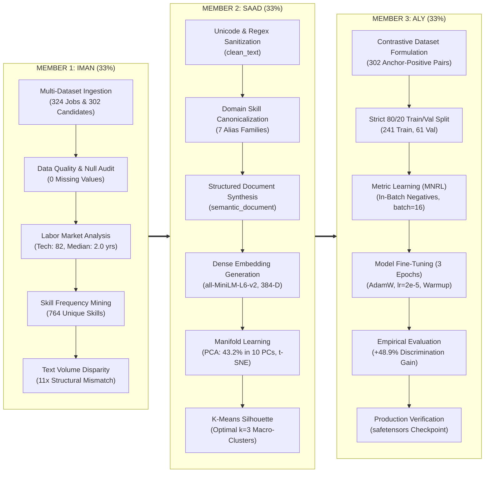

# 🎓 TEAM PRESENTATION & VIVA MASTER GUIDE
## AI Resume Analyzer & Recommendation Intelligence
### End-to-End Data Science, Exploratory Analysis, Manifold Learning & Embedding Fine-Tuning Pipeline
**Team Members**: Iman (33.3%), Saad (33.3%), Aly (33.3%)  
**Notebook Reference**: [`ai_resume_data_science_pipeline.ipynb`](file:///o:/ME/VIT/projects/python_fds/AI-Resume-Analyzer/backend/notebooks/ai_resume_data_science_pipeline.ipynb)

---

## 👥 33% / 33% / 33% Equal Task Division Matrix

---

## ⏱️ Seamless 10-Minute Presentation Script & Flow

### 🎤 Part 1: IMAN (Minutes 0:00 – 3:30)
- **Introduction**: Introduce the team and problem statement (traditional ATS keyword matching rejects qualified talent).
- **Walkthrough**:
  - Show dataset ingestion (`job_roles.csv` and `CareerCorpus.xlsx`).
  - Present the bar charts of Top Job Categories and Experience Distribution (Median 2.0 yrs, right-skewed).
  - Present the Top 20 skills mined (764 unique skills; Python, SQL, Git dominance).
  - Present candidate domain balance (6 domains) and Inter-Annotator Agreement ($r = 0.852$).
  - **The Climax Slide**: Present the KDE Word Count distribution (Resumes 48.7 words vs Jobs 4.2 words).
- **Handoff Line to Saad**:
  > *"Because our exploratory data analysis proved an 11-fold structural word count mismatch between resumes and job postings, keyword matching is mathematically obsolete. To bridge this gap with dense semantic vectors, I now hand over to Saad, who led our text feature engineering, embedding generation, and dimensionality reduction."*

---

### 🎤 Part 2: SAAD (Minutes 3:30 – 6:45)
- **Walkthrough**:
  - Explain text cleaning (`clean_text`), removing `\ufffd` artifacts and extra whitespace.
  - Explain `SKILL_ALIASES` canonicalization dictionary (`ML` $\to$ `Machine Learning`, `AWS` $\to$ `Cloud`).
  - Explain the creation of `semantic_document` for both jobs and candidates.
  - Explain encoding into 384-dimensional dense vectors using `all-MiniLM-L6-v2` (`(324, 384)` and `(302, 384)`).
  - Walk through **PCA Scree Analysis**: top 2 PCs explain 22.50% variance, top 10 explain 43.20%, and the 2D PCA scatter proves resumes and jobs share an overlapping semantic manifold.
  - Walk through **t-SNE 2D Manifold**: demonstrate natural unsupervised clustering of Tech/Data, Banking/Finance, and Teaching.
  - Walk through **K-Means Silhouette Analysis**: optimal $k=3$ macro-clusters.
- **Handoff Line to Aly**:
  > *"While pre-trained embeddings capture general cluster separation, general transformers struggle with fine-grained career matching. To adapt the embedding space directly to labor market recruitment, I hand over to Aly, who designed our contrastive training pipeline, fine-tuned the model, and measured the empirical benchmark improvements."*

---

### 🎤 Part 3: ALY (Minutes 6:45 – 10:00)
- **Walkthrough**:
  - Explain `DOMAIN_TO_JOB_MAP` linking candidate domains to job categories, creating 302 Anchor-Positive pairs.
  - Explain the strict 80/20 train/validation split (241 train, 61 val) with seed 42.
  - Explain the math and efficiency of **Multiple Negatives Ranking Loss (MNRL)** with in-batch negative sampling (batch size 16 = 15 negatives per sample without manual annotation).
  - Walk through the training run (3 epochs, lr=2e-5, AdamW, saved to `backend/models/fine_tuned_resumemodel/`).
  - **The Benchmark Comparison (The Winning Numbers)**:
    - Matched Cosine Similarity jumped from **0.3417** $\to$ **0.4795**.
    - Separation Margin expanded from **0.0568** $\to$ **0.0846** (**+48.9% gain**).
    - Show the Boxplot and Bar Chart.
  - Verify production checkpoint files (`model.safetensors`, `config.json`).
  - Conclude with full-stack integration into SQLite and ChromaDB.
- **Closing Line**:
  > *"In conclusion, Madam, our three-stage pipeline successfully demonstrates how data science, exploratory manifold learning, and contrastive metric learning work together to build a recruitment intelligence engine that achieves a 48.9% improvement in candidate discrimination."*

---

## 📑 Individual Member Guides

Each teammate has their dedicated presentation and viva preparation file:
1. **Iman's Guide**: [`MEMBER_1_IMAN.md`](file:///o:/ME/VIT/projects/python_fds/AI-Resume-Analyzer/backend/notebooks/MEMBER_1_IMAN.md)
2. **Saad's Guide**: [`MEMBER_2_SAAD.md`](file:///o:/ME/VIT/projects/python_fds/AI-Resume-Analyzer/backend/notebooks/MEMBER_2_SAAD.md)
3. **Aly's Guide**: [`MEMBER_3_ALY.md`](file:///o:/ME/VIT/projects/python_fds/AI-Resume-Analyzer/backend/notebooks/MEMBER_3_ALY.md)
